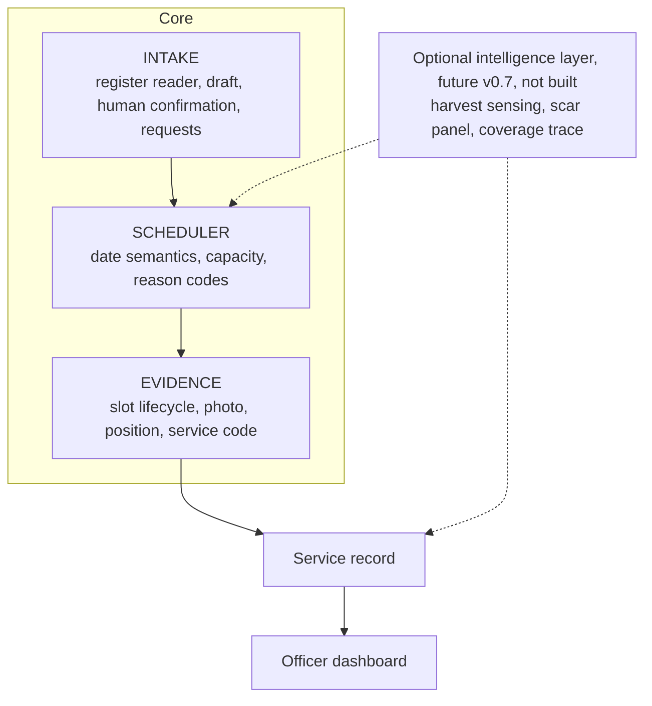
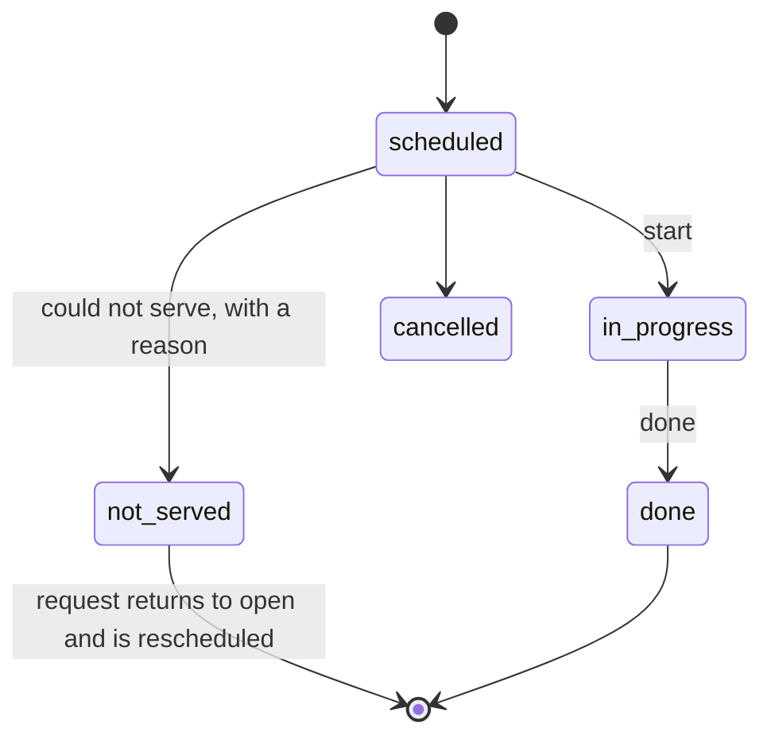
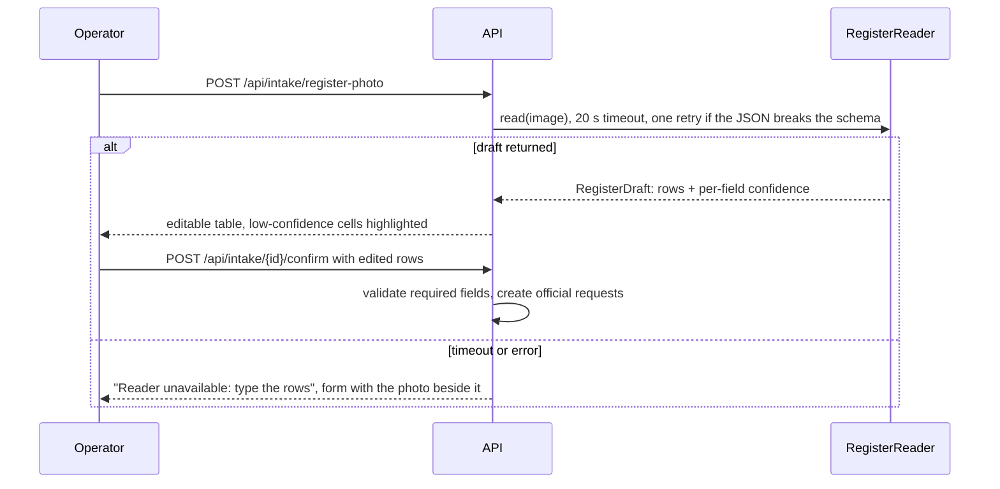
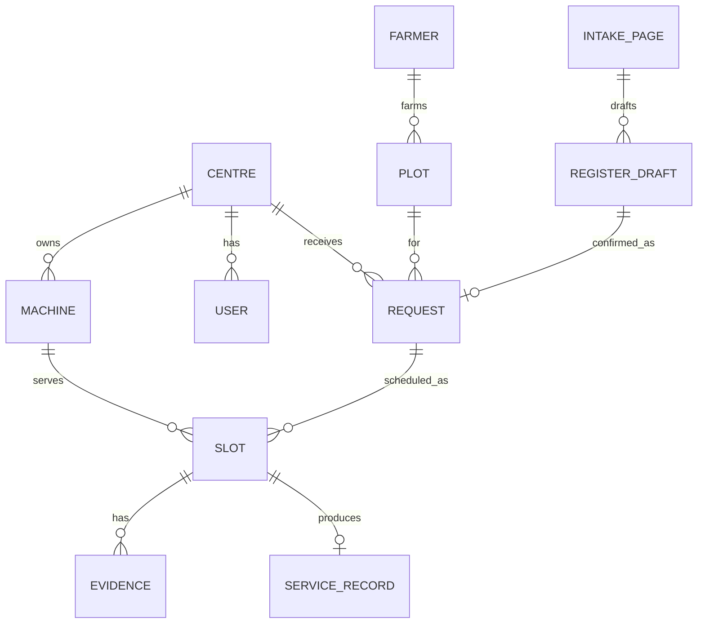

# Architecture

> Exact field lists, enums, routes and rules for the build are in [CONTRACT.md](CONTRACT.md). This page explains the design. Where they differ, the contract wins.

One Python process does everything: API, scheduler, intake, evidence and the static frontend, over a SQLite file. Satellite sensing is future (v0.7), not built ([design](FUTURE_SATELLITE.md)); when it is built, it and the coverage trace will live in an optional layer that the core never imports.

Build order follows one rule: **workflow first, intelligence second, optimisation third, production hardening last.** Tiers are defined in [BUILD_PLAN.md](BUILD_PLAN.md).

## 1. Goals and non-goals

| Goals | Non-goals |
| --- | --- |
| Close the loop from a register entry to a service record, live | A farmer app, a marketplace, payments |
| Ask the operator for one small new habit: a photo an evening and a quick check of drafted rows | An automated burn verdict that decides anything |
| Explain every automated decision: what, why, from what data, what next | Any model whose wrong answer can hurt someone before a person sees it |
| Keep working, and say so, when any one dependency fails | Multi-tenant scale and high availability before a pilot |

## 2. Shape of the system



```mermaid
flowchart LR
  F[Farmer] -- phone call --> OP[Operator or facilitator]
  OP -- form or register photo --> V[Vaari]
  V -- slot message, wa.me link --> F
  D[Driver's phone] -- Start and Done --> V
  V -- will-miss list, usage report --> OF[Village officer]
  V -- shareable record and receipt --> F
  V -. one call per page .-> VLM[Hosted vision model]
  V -. future v0.7, not built .-> S2[Sentinel-2 and Sentinel-1]
```

## 3. Interfaces

Every unreliable dependency sits behind an interface with a mock. Routes depend on the interface, never on a provider, so a model or an API can be swapped without touching FastAPI code.

```python
class RegisterReader(Protocol):
    def read(self, image: bytes) -> RegisterDraft: ...
# MockRegisterReader · GeminiDemoReader (demo only, images go to Google) · CustomModelReader (stub, see FUTURE_CUSTOM_READER.md)

class Scheduler(Protocol):
    def plan(self, requests, machines, today) -> Plan: ...
# GreedyDeadlineFirst (default, deterministic) · RoutingSolver (v0.4)

class Notifier(Protocol):
    def notify(self, slot) -> Message: ...
# ScreenNotifier · WaLinkNotifier · WhatsAppBusinessNotifier (v0.5)

class PositionChecker(Protocol):
    def check(self, fix, plot) -> Plausibility: ...

class HarvestSensor(Protocol):            # future (v0.7), not built: docs/FUTURE_SATELLITE.md
    def sense(self, plot) -> HarvestInterval: ...
# MockHarvestSensor · Sentinel2HarvestSensor
```

The vertical slice is built on the mocks first. Real implementations replace them one at a time.

## 4. Date semantics

Decided before code, because an off-by-one here silently drops the most urgent requests.

| Field | Meaning |
| --- | --- |
| `harvest_date` | The day the paddy was, or will be, cut. Stated by the farmer; the operator may correct it |
| `sow_by` | The agronomic target for sowing wheat. Default `harvest_date + window_days`, with `window_days = 20`, configurable per season |
| `deadline_date` | **The last acceptable service date, inclusive.** Default `sow_by − buffer_days(service_type)`: 0 for a seeder that sows in the same pass, 2 for balers and mulchers (proposed). It is stored, shown in the UI as the one date that matters, and never recomputed silently |
| `service_date` | The date of a scheduled slot |
| `done_at` | The server timestamp of completion |

- A slot on day `d` is feasible if and only if `max(today, harvest_date) <= d <= deadline_date`.
- A request is **on time** when the **IST** date of `done_at` is on or before `deadline_date`. (`done_at` is UTC; between 00:00 and 05:30 IST the UTC date is still yesterday.)
- **Today** is the date in Asia/Kolkata, read only through `clock.today()`, which tests and rehearsals can override.
- `deadline_date < harvest_date` is an invalid request. `deadline_date < today` is `DEADLINE_PASSED`. `deadline_date == harvest_date` is a valid boundary.

## 5. Scheduler

Deterministic for the same inputs. No randomness, stable ordering everywhere.

**Priority order for every request:** valid request → deadline feasibility → machine compatibility → machine availability → machine capacity → estimated travel cost → stable tie-break (`deadline_date`, `created_at`, `id`).

```text
plan(requests, machines, today):
  for r in sort(open requests, by (deadline_date, created_at, id)):
    if not valid(r):                      will_miss(r, INVALID_REQUEST);        continue
    if r.deadline_date < today:           will_miss(r, DEADLINE_PASSED);        continue
    C = machines compatible with r.service_type, sorted by id
    if C is empty:                        will_miss(r, NO_COMPATIBLE_MACHINE);  continue
    best = None
    for day in days_inclusive(max(today, r.harvest_date), r.deadline_date):   # the deadline day IS tried
      for m in C:
        if not m.active_on(day):          continue
        if m.free_acres(day) < r.acres:   continue
        cost = extra_travel(m.route(day), r.centroid)      # nearest-neighbour insertion
        best = min(best, (day, cost, m.id))                 # earliest day, then cheapest, then lowest id
      if best: break
    if best: assign(r, best)
    else:    will_miss(r, why(r, C))      # MACHINE_UNAVAILABLE, TRAVEL_INFEASIBLE or NO_CAPACITY
```

### Reason codes

| Code | When | Suggested action shown to the operator |
| --- | --- | --- |
| `INVALID_REQUEST` | Missing acres, or deadline before harvest | Correct the request |
| `DEADLINE_PASSED` | The deadline is before today | Call the farmer; record the outcome |
| `NO_COMPATIBLE_MACHINE` | No machine serves this service type | Refer to another centre |
| `MACHINE_UNAVAILABLE` | Compatible machines exist, none active in the window | Check repairs; ask a nearby centre |
| `TRAVEL_INFEASIBLE` | In v0.1: the field's estimated travel distance is beyond the centre's service radius (25 km by default). An hours-based day model arrives with the routing solver in v0.4 | Refer to the nearest centre that offers the service |
| `NO_CAPACITY` | Every compatible machine-day before the deadline is full | Check the alternate centre listed |

Every decision carries an explanation object, so the UI never says "the system decided":

```json
{
  "status": "will_miss",
  "reason_code": "NO_CAPACITY",
  "reason": "No compatible machine has 2.5 free acres on or before 24 Oct.",
  "data_used": { "acres": 2.5, "deadline_date": "2026-10-24", "machines_checked": 3 },
  "next_action": "Ask Centre B, 8.4 km away.",
  "nearest_alternative": "Centre B",
  "alternative_distance_km": 8.4
}
```

Distance is straight-line × 1.3, labelled **estimated travel distance**, never "kilometres driven". "Will miss" is an operational status. It is never a statement about what a farmer will do.

## 6. Slot lifecycle: an enforced state machine



The backend enforces transitions. The frontend cannot skip one.

| Transition | Requires | Rejected with |
| --- | --- | --- |
| `start` | The slot's own link or an operator; status `scheduled`; server timestamp; a photo (Tier 1); a position if the phone gives one | `WRONG_SLOT`, `UNAUTHORIZED`, `DUPLICATE_START`, `INVALID_TRANSITION`, `EVIDENCE_MISSING` |
| `done` | Status `in_progress`; server timestamp; a photo (Tier 1); the farmer's service code if he gives it | `INVALID_TRANSITION` for Done before Start, `EVIDENCE_MISSING` |
| `not_served` | A reason: `FIELD_NOT_READY`, `FARMER_ABSENT`, `MACHINE_BROKEN`, `WEATHER`, `OTHER` | `INVALID_TRANSITION` |

A photo is required when the farmer gave evidence consent; without it the job closes with times only (see PRIVACY.md). A position is requested and never blocks: without one the job still closes, badged "position self-reported". Flags such as `position_mismatch`, `too_fast`, `exact_duplicate_photo` and `code_missing` set `needs_review`. They never change the state, and they never penalise anyone.

The request has its own small machine: `open → scheduled → done`, with `needs_info` (no harvest date yet), `will_miss` and `cancelled`. `needs_info` is a request that cannot be planned yet; `needs_review` is a job whose evidence raised a flag. They are different counts on different screens. An invariant test checks after every scheduler run that each request is in exactly one state, because forgotten callers are the first pain this product exists to remove.

## 7. Evidence: plausibility, not proof

| Signal | What is stored | What it means |
| --- | --- | --- |
| Time | Server time only. The phone's clock is ignored | When the server heard about it |
| Position | `lat`, `lon`, `accuracy_m` as **reported by the device**, `distance_to_plot_m`, `plausible` | Supporting evidence, checked against the expected plot. The device reports its own accuracy, so reported accuracy is not actual accuracy. A position can be spoofed |
| Photo | File on disk and its SHA-256 computed from the raw bytes | **Exact duplicate detection only.** A resized, cropped or re-encoded copy passes. Perceptual hashing comes later |
| Duration | `done_at − started_at` against acres | Under 25 minutes per acre flags `too_fast` (proposed; a seeder takes roughly an hour per acre, to be confirmed with operators) |
| Service code | A 4-digit code in the farmer's slot message, entered by the driver at Done | The one signal that needs the farmer. It stops jobs faked without his knowledge. It does not stop collusion. It never blocks a job |
| Custody log | One `event_log` row per capture, check and view | Who touched the evidence, and when |

```json
{ "lat": 30.2451, "lon": 75.8412, "accuracy_m": 18, "distance_to_plot_m": 24, "plausible": true }
```

Plausible means the fix lies inside the plot widened by the larger of 30 m and the reported accuracy. The record hash covers the slot, both evidence rows and their photo hashes. **It shows whether a record was edited after capture. It cannot show that the position was honest at capture.**

## 8. Intake: a draft, never a request



- The model's output is stored as a `register_draft`, so a confirmation survives a restart. Only confirmed rows become requests.
- Guardrails: a fixed JSON schema; phone must be 10 digits, acres 0.25–200, dates inside the season; failing cells are highlighted, not dropped. The name is optional, because the phone number is the key.
- The register image is deleted after confirmation and a short retention period. See [PRIVACY.md](PRIVACY.md).
- Evaluation is reported as counts: rows usable without edits, wrong fields by type, seconds per page. Below half usable, the form becomes the primary intake.

## 9. Data model

Geometry is stored as GeoJSON text and handled with shapely. **The schema is the one expensive thing to change later.** The table below is the summary; the complete column list, which phase 1 creates in full, is in [CONTRACT.md](CONTRACT.md#6-data-model). Acres are stored as integer hundredths (`acres_x100`) so capacity comparisons are exact.



| Table | Key fields |
| --- | --- |
| `centre` | id, name, phone, lat, lon |
| `machine` | id, centre_id, type, service_types, capacity_acres_per_day, implement_width_m, active_from, active_to, status |
| `user` | id, centre_id, role (operator, driver, officer, reviewer), display_name. **Demo only: no passwords in v0.1** |
| `farmer` | id, name (optional), phone, language, consent_service, consent_evidence, consent_share, consent_at |
| `plot` | id, farmer_id, village, geojson, acres, centroid_lat, centroid_lon |
| `intake_page` | id, image_path, image_delete_after, reader, prompt_version, latency_ms, status |
| `register_draft` | id, intake_page_id, row_json, confidence_json, edited, confirmed_at, request_id |
| `request` | id, plot_id, centre_id, service_type, source, harvest_date, sow_by, deadline_date, status, reason_code, reason, next_action, created_at |
| `slot` | id, request_id, machine_id, service_date, seq, status, service_code, notified_at, started_at, done_at, not_served_reason, needs_review |
| `evidence` | id, slot_id, kind (start, done, extra), server_time, lat, lon, accuracy_m, distance_to_plot_m, plausible, photo_path, photo_sha256. Never updated |
| `service_record` | id, slot_id, token, outcome, flags, record_hash, generated_at |
| `message_log` | id, farmer_id, channel, template, body, status |
| `event_log` | id, actor, entity, entity_id, event, payload_json, at. Append-only |
| Optional layer | `trace`, `orbit_check`, `review` |

## 10. Optional intelligence layer (future (v0.7), not built)

Nothing in this section exists in code. When built, nothing in the core will import it; it will read plots and write its own tables, and it may only suggest. See [FUTURE_SATELLITE.md](FUTURE_SATELLITE.md).

- **Harvest sensing.** Mean NDVI per clear Sentinel-2 scene on 10 m bands; "harvested between A and B", never a single day; the stated date wins. Not validated on Punjab paddy, so it reports "k of N intervals held".
- **Scar panel.** Baseline after harvest and before Start, never pre-harvest. Three soft outputs, no decision.
- **Rules borrowed from open burn mappers:** pair scenes from the same MGRS tile; resample 10 m bands down to the 20 m grid; assert indices stay in [−1, 1] and areas sum to the plot.
- **Coverage trace.** The phone's path, widened by half the implement width, unioned and intersected with the plot. A trace simulator replays a recorded path for tests.

$$
NDVI = \frac{NIR - Red}{NIR + Red} \qquad dNBR = NBR_{baseline} - NBR_{follow\text{-}up} \qquad covered\ share = \frac{area(buffer(path, w/2) \cap plot)}{area(plot)}
$$

## 11. Fallbacks with a visible status

| Dependency dies | What happens | What the screen says |
| --- | --- | --- |
| Vision model | The form opens with the photo beside it | "Reader unavailable: type the rows" |
| WhatsApp | `wa.me` link, then the on-screen message | "Not sent: copy or call" |
| Phone cannot reach the server over HTTPS | Start and Done in the laptop's browser | Badge: "position self-reported" |
| Satellite source (future (v0.7), not built) | Precomputed, hand-exported chips | Badge: "exported by hand" |
| Database file | The seed script rebuilds it in under a minute | — |
| Server laptop | A second laptop with the same repo, seed and photos | — |

`GET /api/health` reports each dependency, and the Desk shows a status strip. A fallback that hides itself is a bug.

## 12. Security: demo versus production

| v0.1, **DEMO ONLY** | Before any pilot |
| --- | --- |
| A shared passcode header; per-slot links for the driver; a 128-bit token per record | Authentication, role-based authorisation, secure sessions or tokens |
| Pydantic validation; a photo size limit; image content-type check | Upload validation with re-encoding, size limits, malware scanning |
| Request logging | Rate limiting, CORS and CSRF controls, audit logs with a hash chain |
| Secrets in `.env` | Managed secrets, encrypted backups |

## 13. Testing, deployment, scaling

- Testing is specified in [TESTING.md](TESTING.md): deadline boundary tests first, then API and state-machine tests, then one end-to-end scenario, then every fallback path.
- **Dev:** every laptop runs the full stack on its own SQLite file. **Demo:** one laptop serves; a free tunnel gives the phone HTTPS. **Observability:** structured logs, `event_log`, `/api/health`.
- **Scaling path:** ten centres need nothing. A hundred need Postgres, object storage and a job queue. A thousand need an India-hosted or on-device reader. Scheduling is per centre, so it parallelises for free. None of this is built before the workflow is proven.
