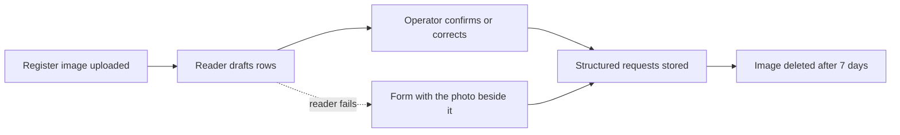

# Privacy and data retention

Vaari handles farmers' phone numbers, plot locations and photos of fields. This page says what is collected, why, where it lives, who can see it, how long it is kept, and when it is deleted.

Three rules sit above everything else:

1. **Collect the minimum.** No Aadhaar, no land records, no bank details. The farmer's name is optional. A [CEEW survey](https://www.ceew.in/publications/how-can-punjab-adopt-crop-residue-management-methods-and-tackle-paddy-stubble-burning) links an earlier state app's low use to the personal data it demanded.
2. **Keep raw material briefly.** Structured rows replace register images as soon as a person has confirmed them.
3. **No record may be used against a farmer.** See [Responsible use](../README.md#responsible-use).

Retention periods below are proposed defaults for a pilot, to be reviewed against India's data-protection rules before any real deployment. That review has not been done yet.

## 1. Data inventory

| Data class | What it contains | Why it is collected | Where it is stored | Who can see it | Kept for | Deleted |
| --- | --- | --- | --- | --- | --- | --- |
| Register image | A photo of a handwritten page: names, numbers, acres, dates | To draft requests without typing | Disk, `data/register_pages/`, never in git | The operator who uploaded it | Until every row is confirmed or discarded, then 7 days | Automatically, by a daily job. `image_delete_after` is set at upload |
| Register draft | The reader's rows and per-field confidence | So confirmation survives a restart, and reader quality can be measured | Database | The operator | 30 days after confirmation | Rows are stripped to counts: total, edited, confidence |
| Structured request | Phone, optional name, village, acres, service, dates | To schedule and notify | Database | Operator; officer sees status, village and acres | One season plus 12 months | Anonymised: phone and name removed, village and dates kept |
| Plot | Outline or pin, acres, village | To cluster jobs and check position | Database | Operator; officer | While the farmer is active, then as above | With the farmer's record |
| Evidence photo | The field at Start and at Done | To evidence the job | Disk, `data/photos/`, never in git | Operator, reviewer, and anyone holding the record link | One season plus 12 months | File deleted; hash and metadata kept |
| Position fix | Latitude, longitude, reported accuracy, distance to plot | A plausibility signal | Database | As for evidence photos | As for evidence photos | With the photo |
| Service record | The job's timeline, flags and hash | A receipt, a job sheet, a usage report | Database | Anyone holding the link. It shows village and plot, never a full name or phone | One season plus 12 months | Anonymised |
| Audit and event metadata | Who did what, when | Custody and debugging | Database, append-only | Operator, reviewer | 24 months | Aggregated |
| Messages | The rendered slot message | Delivery evidence | Database | Operator | One season | Deleted |

## 2. The register-image lifecycle

- The original image is **not needed after confirmation**. It is kept for a few days only so a disputed row can be checked.
- **No real register page is sent to a hosted model.** An operator's permission is not his farmers' permission. For tests and demos, pages are re-copied with made-up entries, or the phone column is covered before the photo is taken.
- A real pilot needs an India-hosted or on-device reader, or the farmers' own consent. Until then the form is the intake for real data.

## 3. Consent

Three separate consents, stored per farmer with a timestamp:

| Consent | Allows | Without it |
| --- | --- | --- |
| Service | Scheduling and the slot message | No request is created |
| Evidence | Photos and position for his job | The job closes with times only |
| Sharing | Showing the record to a payer or officer by name | Officers see status, village and acres; no record link is shared |

In v0.1 the operator ticks these boxes, so **consent is simulated**, and every screen that depends on it says so. Consent captured from the farmer's own phone arrives with WhatsApp Business messaging in v0.5.

## 4. Access by role

| Role | Requests | Will-miss list | Evidence photos | Register images | Records |
| --- | --- | --- | --- | --- | --- |
| Operator | Full | Full | Full | Own uploads | Full |
| Driver | Own jobs for the day | — | Own uploads | — | Own jobs |
| Officer | Status, village, acres | Full, without phone numbers | Only where sharing consent exists | — | Only where sharing consent exists |
| Reviewer | Jobs flagged for review | — | Flagged jobs | — | Flagged jobs |
| Farmer | — | — | Through his record link | — | His own, by link |

v0.1 has a shared demo passcode and no roles, so this matrix is a design, not a control. It becomes enforceable in v0.6.

## 5. A farmer's requests

A farmer can ask the operator to see what is held about him, to correct it, and to delete it. Deletion removes the phone number, name, photos and plot outline, and keeps an anonymised job count for the centre's usage report.

## 6. Third parties

| Party | What it receives | Safeguard |
| --- | --- | --- |
| Hosted vision model | A page image | Synthetic or masked pages only, until a compliant reader exists |
| WhatsApp, through a `wa.me` link | The slot message, sent from the operator's own account | The operator already holds the farmer's number. Vaari's server sends nothing |
| Earth Search (optional layer) | A bounding box around a plot | No personal data. Imagery is public |
| Tunnel provider (demo) | Encrypted traffic | Demo only |

## 7. Security of stored data

v0.1 is a demo on one laptop: secrets in `.env`, data folders in `.gitignore`, nothing personal in the repository. A pilot adds encrypted disks and backups, role-based access, audit logs and a documented breach procedure. See [SECURITY.md](../SECURITY.md).

## 8. What Vaari never collects

Aadhaar numbers, land records, bank details, caste or income, photos of people, continuous location of a farmer, or any data about fields that were not part of a request.

## 9. Pilot v0.2 changes

What the pilot build adds, and what it still does not do:

- **Photo metadata is removed.** Every uploaded photo (start, done and register pages) is decoded, turned upright and saved again as a plain JPEG with no EXIF, GPS, camera model, time or comments (`app/storage/sanitize.py`). The position Vaari keeps is the one the phone reports to the API, with its accuracy.
- **Logs carry no personal data.** Logs are JSON lines with a request ID and the route *template* (never a real path, query string, body, name, phone, token or image). A filter also masks anything shaped like a mobile number or a link token (`app/logging_setup.py`).
- **Role-based access.** Operators see what they need to run the centre, including phone numbers. Officers see oversight views with no phone numbers and no driver links. Every sign-in is per person, and actions are logged against the account (`event_log.actor`, for example `operator:asha`).
- **Links expire and can be turned off.** Driver links last 30 days, record links 365, and an operator can cut either off at once.
- **Backups hold personal data.** A backup is a full copy of the database and photos. Keep backups encrypted or on media only the centre can reach, and delete old ones (`backup --keep N`).
- **Third parties.** The Gemini reader sends register photos to Google. It is for demonstration on synthetic pages only, is off by default, and production refuses to start with it unless overridden on purpose. The intake screen always says where photos go. The optional Desk map loads tiles from OpenStreetMap, which reveals the approximate area being viewed to that service.
- **Not done yet:** encryption at rest (use an encrypted disk), a documented breach procedure, consent captured from the farmer's own phone (consent is still recorded by the operator), and any collection of training data, which is deliberately not built (`docs/FUTURE_CUSTOM_READER.md`).
